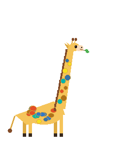
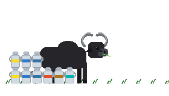
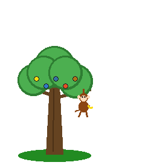
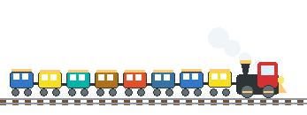

# 🦁 Git-Safari

<p align="center">
  
  
  
</p>

<p align="center">
  <b>Dynamic, living animated companions for your GitHub profile README!</b><br>
  <i>Watch your Giraffe grow an impossibly tall neck, your Buffalo stack milk cans for every 100 commits, your Monkey swing in a growing jungle tree, your Code Train chug across the tracks, and your Snowman expand with your contributions!</i>
</p>

<p align="center">
  
  
  
  
</p>

---

## 🌟 The Safari Lineup (Live Animated Previews)

Every creature is generated **algorithmically** directly from your public GitHub profile activity and programming languages:

| Creature | How It Scales with Your GitHub Data | Live Preview |
| :--- | :--- | :---: |
| 🦒 **The Giraffe** | **Neck stretches taller** as your total contributions climb! Its spots are dyed with your top programming languages. Bends gently in the wind while chewing leaves. |  |
| 🐃 **The Buffalo** | Stands chewing cud while **shiny milk cans line up beside it (1 milk can for every 100 commits!)**, each can wrapped with your language badge ribbons. |  |
| 🐒 **The Monkey & Tree** | **The tree branches taller** as your commit history grows! A playful monkey swings from the canopy holding a golden banana alongside glowing language fruits. |  |
| 🚂 **The Snake Train** | **Carriages lengthen** with contributions! Each carriage represents your codebase languages while piston wheels turn and steam puffs float up. |  |
| ⛄ **The Snowman** | **Belly diameter expands** with commits (from a tiny snowball to a rotund frosty snowman!). Wears a scarf & hat ribbon striped with your languages amidst falling snow. |  |

---

## 🚀 How to Add Git-Safari to Your Profile README

You can add any creature to your GitHub profile repository (`<your-username>/<your-username>`) in 2 simple steps:

### Step 1: Create the GitHub Actions Workflow
In your profile repository, create `.github/workflows/safari.yml`:

```yaml
name: Git-Safari

on:
  schedule:
    # Runs daily at midnight UTC
    - cron: "0 0 * * *"
  workflow_dispatch: # Allows manual trigger anytime
  push:
    branches: [main]
    paths: [.github/workflows/safari.yml]

permissions:
  contents: write

concurrency: safari

jobs:
  safari:
    runs-on: ubuntu-latest
    steps:
      - uses: actions/checkout@v4

      # Choose: giraffe, buffalo, monkey_tree, snake_train, snowman, or all
      - uses: Nightkilller/git-safari@v1
        with:
          creature: giraffe # Change to buffalo, snowman, snake_train, monkey_tree, or all
          output-dir: safari

      - name: Commit if changed
        shell: bash
        run: |
          git add safari/*.gif
          if git diff --cached --quiet; then
            echo "Safari unchanged; nothing to commit."
            exit 0
          fi
          git config user.name "github-actions[bot]"
          git config user.email "41898282+github-actions[bot]@users.noreply.github.com"
          git commit -m "safari: update companion growth & languages"
          git push
```

### Step 2: Embed the Creature in Your `README.md`

Add this anywhere in your profile `README.md`:

```html
<div align="center">
  
</div>
```

*(You can replace `giraffe.gif` with `buffalo.gif`, `monkey_tree.gif`, `snake_train.gif`, or `snowman.gif`!)*

---

## ⚙️ Workflow Options

| Input | Default | Description |
| :--- | :--- | :--- |
| `creature` | `giraffe` | Which companion to draw: `giraffe`, `buffalo`, `monkey_tree`, `snake_train`, `snowman`, or `all` |
| `username` | `${{ github.repository_owner }}` | GitHub user whose stats will power the companion |
| `output-dir` | `safari` | Directory relative to workspace where `.gif` files are saved |
| `token` | `${{ github.token }}` | Token used to read public stats (the default workflow token is enough) |

---

## 💻 Local Command Line Usage

You can also run Git-Safari locally on your machine for any GitHub user:

```bash
# 1. Clone the repository
git clone https://github.com/Nightkilller/git-safari.git
cd git-safari

# 2. Install dependencies
pip install -r requirements.txt

# 3. Generate any creature for any user!
python3 -m src.cli --username Nightkilller --creature giraffe --output-dir dist
python3 -m src.cli --username torvalds --creature all --output-dir dist
```

---

## 🧠 The Science & Engineering

How does Git-Safari turn raw GitHub statistics into living artwork?

1. **Logarithmic Scaling**:
   Creature dimensions scale using a logarithmic growth formula:
   $$S = S_0 + K \cdot \ln(1 + \text{contributions})$$
   This rewards new coders immediately with visible growth while preventing massive contributors from overflowing the canvas.

2. **Language Color Extraction**:
   Git-Safari queries the GitHub GraphQL/REST APIs to collect your repository languages. The exact GitHub hex colors (e.g. Python `#3572A5`, JavaScript `#F7DF1E`, C++ `#F34B7D`, Java `#B07219`) are sampled and mapped to spots, ribbons, train carriages, and milk can bands.

3. **Kinematic Periodic Looping**:
   Every frame uses periodic trigonometric functions ($A \sin(\omega t)$) to drive spine swaying, ear flicking, wheel rotations, and tail wags. This guarantees a seamless, infinite loop at 15 FPS with zero stutter.

---

## 🤝 Contributing

Contributions, new animal designs, and bug fixes are welcome! Feel free to open an Issue or submit a Pull Request.

---

## 📄 License

MIT License © 2026 [Aditya Gupta (Nightkilller)](https://github.com/Nightkilller).
